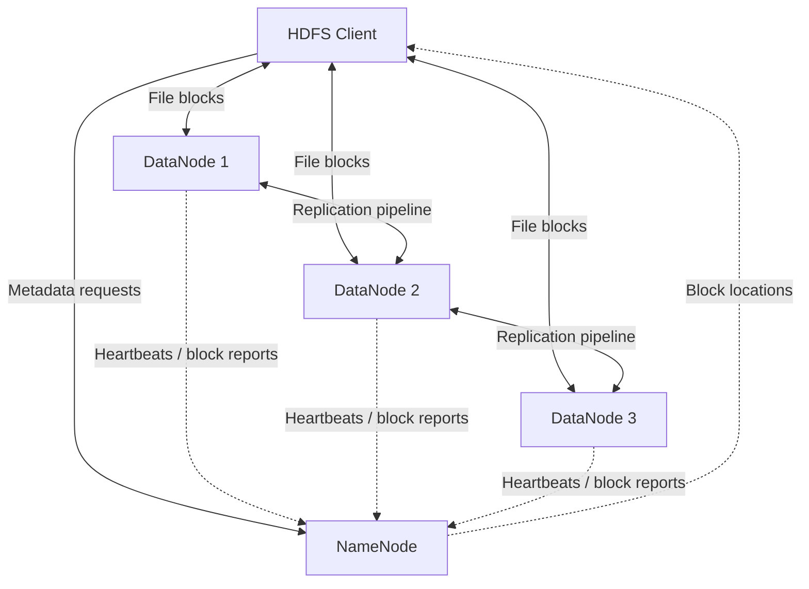
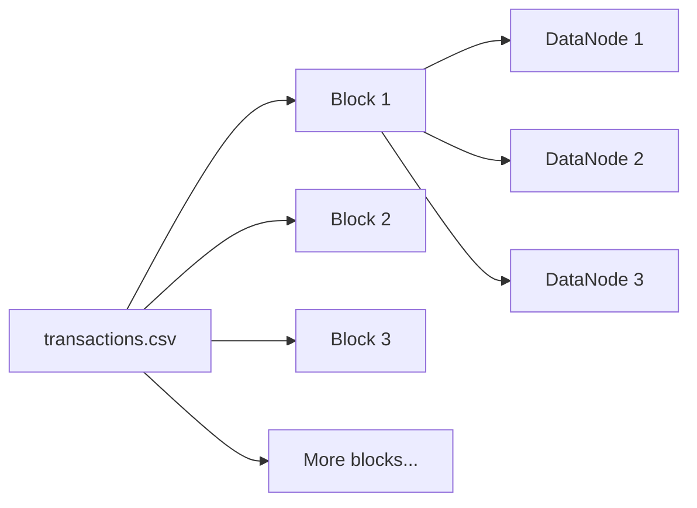

# HDFS Under Attack

**Laboratorio de Hadoop y HDFS con Docker Compose**

En esta práctica construiremos un clúster HDFS, almacenaremos un archivo en bloques, inspeccionaremos sus réplicas y provocaremos fallos para observar cómo responde el sistema. El laboratorio está pensado para realizarse en clase, paso a paso, y después resolver un incidente sin una receta cerrada.

## 1. Qué aprenderemos

Al terminar podrás:

- Explicar qué información conserva el NameNode y qué almacenan los DataNodes.
- Comprobar cómo se divide un archivo en bloques y dónde están sus réplicas.
- Cambiar el factor de replicación y observar su impacto.
- Analizar la pérdida de un DataNode y el estado de los bloques.
- Distinguir la recuperación de un nodo, la recuperación de réplicas y la recuperación de archivos eliminados.
- Explicar por qué un NameNode sin alta disponibilidad es un punto único de fallo.

## 2. Arquitectura



El NameNode mantiene el espacio de nombres y la ubicación de los bloques. Los DataNodes conservan los datos reales. El cliente consulta metadatos al NameNode, pero normalmente transfiere los datos directamente con los DataNodes.

| Servicio            | Función                                   | Persistencia              |
| ------------------- | ----------------------------------------- | ------------------------- |
| `namenode`          | Metadatos y coordinación HDFS             | Volumen `namenode-data`   |
| `datanode1`         | Almacenamiento de bloques                 | Volumen `datanode1-data`  |
| `datanode2`         | Almacenamiento de bloques                 | Volumen `datanode2-data`  |
| `datanode3`         | Almacenamiento de bloques                 | Volumen `datanode3-data`  |
| `client`            | Terminal para ejecutar comandos HDFS      | Volumen `client-output`   |
| `dataset-generator` | Regenera el CSV desde Docker; es opcional | Carpeta local `datasets/` |

**Configuración de laboratorio:** bloques de **1 MiB** (`1048576` bytes), factor de replicación **3**, tres DataNodes y NameNode único. El bloque pequeño es intencional: permite ver varios bloques sin necesitar un archivo de cientos de megabytes.

## 3. Preparación

Desde la raíz del repositorio:

```bash
docker compose version
docker compose build
docker compose up -d namenode datanode1 datanode2 datanode3 client
docker compose ps
```

La primera construcción descarga Hadoop 3.4.1 y puede tardar varios minutos. El arranque inicial formatea el NameNode **solo si el volumen de metadatos está vacío**. No ejecutes `hdfs namenode -format` manualmente sobre un volumen que ya contiene datos.

Abre la interfaz web del NameNode en **http://localhost:9870**. En _Datanodes_ deberías ver tres nodos activos. Si todavía no aparecen, espera unos segundos y vuelve a cargar la página.

Verifica el estado desde la terminal:

```bash
docker compose exec client hdfs dfsadmin -report
```

**Antes de continuar:** confirma que el reporte muestra **3 Live datanodes**. Si no es así, consulta `docker compose logs --tail=100 namenode datanode1 datanode2 datanode3`.

## 4. Experimento 1 — ¿Dónde está mi archivo?

El repositorio incluye `datasets/transactions.csv`, con 85.000 transacciones ficticias y más de 4 MiB de contenido.

### 4.1 Crear un directorio en HDFS

```bash
docker compose exec client hdfs dfs -mkdir -p /datasets
```

### 4.2 Subir el archivo

```bash
docker compose exec client hdfs dfs -put /workspace/datasets/transactions.csv /datasets/
```

> : Nota: Si repites la práctica y el archivo ya existe, utiliza `-put -f` para reemplazarlo de manera explícita.

### 4.3 Verificarlo

```bash
docker compose exec client hdfs dfs -ls -h /datasets
docker compose exec client hdfs dfs -du -h /datasets/transactions.csv
docker compose exec client hdfs dfs -cat /datasets/transactions.csv | head -n 5
```

`-du` permite comparar tamaño lógico y espacio consumido con replicación. El uso físico real también incluye metadatos y otros costes.

### 4.4 Localizar bloques y réplicas

```bash
docker compose exec client hdfs fsck /datasets/transactions.csv -files -blocks -locations
```

Anota:

1. ¿Cuántos bloques tiene el archivo?
2. ¿Cuántas réplicas tiene cada bloque?
3. ¿Qué DataNodes almacenan los bloques?
4. ¿Por qué el archivo aparece como una sola ruta aunque esté repartido?

**Diagrama de referencia:**



El diagrama ilustra las réplicas de **un** bloque; no representa la ubicación exacta que tendrá tu archivo. Para conocerla utiliza `fsck`.

## 5. Experimento 2 — ¿Qué cambia al replicar?

Consulta el factor actual:

```bash
docker compose exec client hdfs dfs -stat '%r' /datasets/transactions.csv
```

Reduce el factor a dos y espera a que termine el ajuste:

```bash
docker compose exec client hdfs dfs -setrep -w 2 /datasets/transactions.csv
docker compose exec client hdfs fsck /datasets/transactions.csv -files -blocks -locations
```

Consulta el uso de almacenamiento:

```bash
docker compose exec client hdfs dfs -du -h /datasets/transactions.csv
```

Restablece tres réplicas:

```bash
docker compose exec client hdfs dfs -setrep -w 3 /datasets/transactions.csv
```

**Discusión:** ¿se triplicó el tamaño lógico del archivo? ¿Qué cambió en el consumo físico? ¿Tres copias equivalen a tres backups?

> `-setrep -w` espera a que se alcance el número de réplicas. Con un DataNode apagado, solicitar tres réplicas puede hacer que el comando espere indefinidamente. Ejecuta este paso con los tres DataNodes activos.

## 6. Experimento 3 — Apaga un DataNode

Primero confirma que hay tres réplicas y que el archivo se puede leer:

```bash
docker compose exec client hdfs fsck /datasets/transactions.csv -files -blocks -locations
docker compose exec client hdfs dfs -cat /datasets/transactions.csv | head -n 3
```

Detén un nodo:

```bash
docker compose stop datanode1
```

Comprueba el estado:

```bash
docker compose exec client hdfs dfsadmin -report
docker compose exec client hdfs fsck /datasets/transactions.csv -files -blocks -locations
```

La detección de un nodo muerto **no es inmediata**. Un DataNode detenido puede aparecer temporalmente como activo hasta que el NameNode agote sus temporizadores de detección. Espera y repite el reporte si es necesario.

Prueba la lectura:

```bash
docker compose exec client hdfs dfs -cat /datasets/transactions.csv | head -n 3
```

**Preguntas:** ¿el archivo sigue disponible? ¿Qué diferencia hay entre _under-replicated_ y _missing blocks_? ¿Puede HDFS recuperar tres copias distintas si solo quedan dos DataNodes?

Con dos DataNodes vivos, HDFS puede seguir leyendo bloques con réplicas supervivientes, pero no puede mantener tres copias de cada bloque en tres nodos diferentes. En un clúster real, los resultados dependen de la ubicación de las réplicas y del número de nodos sanos.

## 7. Experimento 4 — Recupera el nodo

```bash
docker compose start datanode1
docker compose exec client hdfs dfsadmin -report
docker compose exec client hdfs fsck /datasets/transactions.csv -files -blocks -locations
```

Espera a que el NameNode vuelva a reconocer el DataNode y verifica las réplicas. Un nodo que regresa con su volumen intacto puede volver a ofrecer bloques existentes; no siempre hay que copiarlos desde cero.

**Pregunta:** ¿recuperar un contenedor es lo mismo que reconstruir bloques perdidos?

## 8. Experimento 5 — ¿Qué pasa si cae el NameNode?

En este laboratorio **no hay NameNode de respaldo**.

```bash
docker compose stop namenode
```

Prueba una operación de metadatos. Para evitar esperas largas, aplicamos un límite de tiempo del lado del cliente:

```bash
docker compose exec client bash -lc 'timeout 20s hdfs dfs -ls /datasets || echo "NameNode unavailable or request timed out"'
```

Los bloques permanecen en los volúmenes de los DataNodes, pero no puedes navegar normalmente el espacio de nombres si el NameNode está fuera de servicio.

Recupera el servicio:

```bash
docker compose start namenode
```

Espera a que el servicio esté listo:

```bash
docker compose exec client hdfs dfs -ls /datasets
```

Si falla inmediatamente, espera unos segundos y repite. **No reformatees el NameNode** para resolver un problema de arranque: perderías la relación con los bloques existentes.

**Discusión:** ¿qué cambiaría si tuviéramos NameNode HA? ¿Por qué distribuir bloques no elimina automáticamente los puntos únicos de fallo?

## 9. Experimento 6 — Replicación no es backup

Antes de eliminar nada, crea una copia local dentro del volumen del cliente:

```bash
docker compose exec client hdfs dfs -get /datasets/transactions.csv /workspace/output/transactions-backup.csv
```

Compara las sumas de verificación del archivo original y la copia:

```bash
docker compose exec client sha256sum /workspace/datasets/transactions.csv /workspace/output/transactions-backup.csv
```

Elimina el archivo de HDFS sin enviarlo a Trash:

```bash
docker compose exec client hdfs dfs -rm -skipTrash /datasets/transactions.csv
```

Comprueba que ya no aparece:

```bash
docker compose exec client hdfs dfs -ls /datasets
```

**Pregunta:** si había tres réplicas, ¿por qué ninguna restaura el archivo eliminado?

La replicación protege frente a fallos de almacenamiento, no frente a eliminaciones lógicas. Aquí la recuperación es posible porque guardamos **una copia separada** antes de borrar.

Restaura el archivo para el desafío final:

```bash
docker compose exec client hdfs dfs -put /workspace/output/transactions-backup.csv /datasets/transactions.csv
```

## 10. Comandos de referencia

| Objetivo             | Comando dentro del cliente                              |
| -------------------- | ------------------------------------------------------- |
| Listar archivos      | `hdfs dfs -ls /datasets`                                |
| Ver tamaños          | `hdfs dfs -du -h /datasets`                             |
| Subir archivo        | `hdfs dfs -put archivo /datasets/`                      |
| Descargar archivo    | `hdfs dfs -get /datasets/archivo .`                     |
| Leer archivo         | `hdfs dfs -cat /datasets/archivo`                       |
| Ver replicación      | `hdfs dfs -stat '%r' /datasets/archivo`                 |
| Cambiar replicación  | `hdfs dfs -setrep -w 2 /datasets/archivo`               |
| Inspeccionar bloques | `hdfs fsck /datasets/archivo -files -blocks -locations` |
| Ver DataNodes        | `hdfs dfsadmin -report`                                 |

En los ejemplos de esta guía se ejecutan desde el host usando `docker compose exec client ...`.
