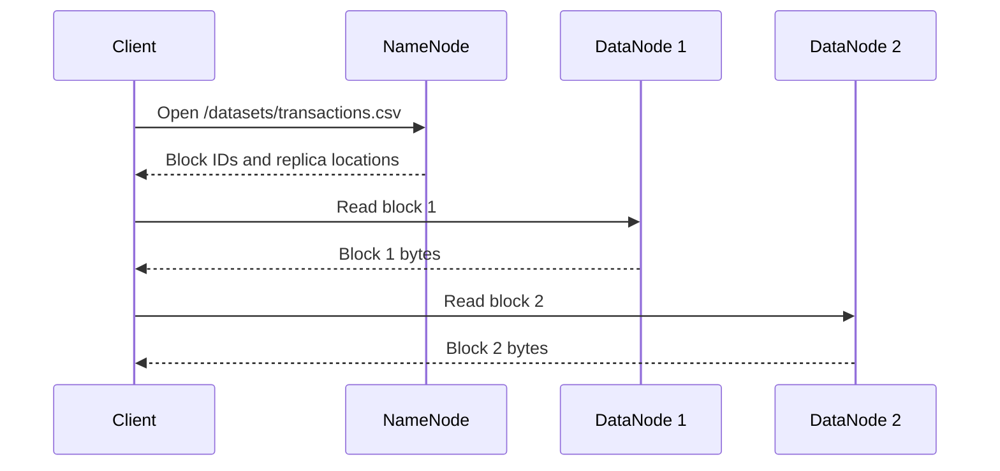
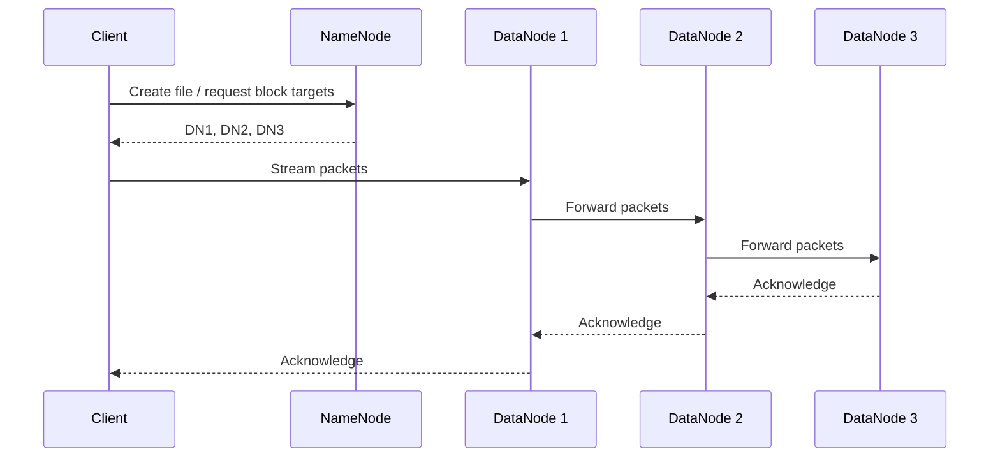
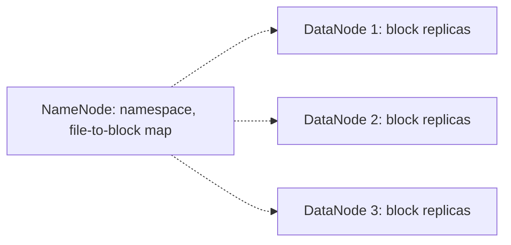

# HDFS: arquitectura y flujos

## Lectura de un archivo

El NameNode responde con metadatos; el cliente obtiene los bytes directamente de los DataNodes. El cliente puede seleccionar réplicas accesibles según la ubicación y las condiciones del clúster.

## Escritura de un bloque

El ejemplo simplifica el protocolo de escritura para mostrar la idea del pipeline. Las confirmaciones y el manejo de errores reales dependen del estado del clúster y de la configuración.

## Almacenamiento frente a metadatos

**Pregunta:** si aumentamos el número de DataNodes, ¿se reduce automáticamente la cantidad de metadatos que mantiene el NameNode? No. El crecimiento de los archivos y los bloques sigue presionando su memoria.
